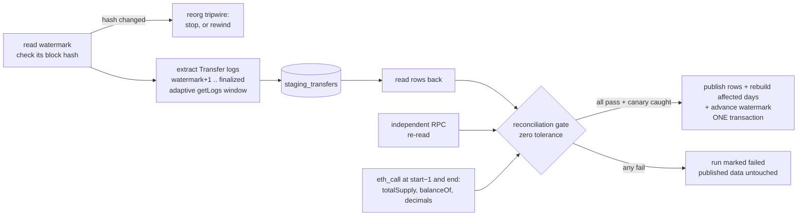

# chainproof

**A reorg-safe ERC-20 indexer that refuses to publish a number it can't prove against chain state.**

Most indexers can produce a number. chainproof checks that the number is right before anyone sees it. Each run extracts `Transfer` logs from finalized blocks into a staging table, then runs a reconciliation gate against the contract's own state at pinned blocks. Rows are published only if every check passes at **zero tolerance**. The same transaction advances a hash-checked watermark.

Pure Python + DuckDB, public RPCs only, no accounts, no API keys.

```
$ chainproof run --chain base --blocks 1800
chainproof 0.1.0: USDC on base
  primary  https://base.drpc.org
  verifier https://base-rpc.publicnode.com
  blocks   53492252..53494051 (1800 blocks, finalized head 53494051)
  rows     129157 transfers published   run 20261104T075402-3c7133b1
  rpc      23 getLogs windows, 5 splits, 34.92s total
  PASS  completeness 129157 rows vs 129157 independent; missing=0 extra=0 value_mismatches=0
  PASS  supply       Δsupply=336671309803 mints-burns=336671309803 diff=0
  PASS  balances     20/20 holders match balanceOf exactly
  PASS  canonical    10 sampled blocks; orphaned=0 blocks_with_two_hashes=0
  PASS  decimals     on-chain=6 config=6
  PASS  canary       planted +1 raw unit at block 53493960 log 31; caught by completeness, balances
```

## Results (live mainnet, 2026-11-04)

| Chain | Blocks | Transfers | Wall time | Net supply change reconciled | Divergence |
|---|---:|---:|---:|---:|---:|
| Base | 1,800 (1 hour) | 129,157 | 35 s | +336,671.309803 USDC | 0 |
| Ethereum | 150 (30 min) | 12,078 | 13 s | +18,727,858.495016 USDC | 0 |
| Arbitrum | 400 | 1,385 | 6 s | +39,068.746593 USDC | 0 |

The supply check is exact to the raw unit: `totalSupply(end) − totalSupply(start−1)` equals `Σ mints − Σ burns`, and 20 holders' `balanceOf` deltas equal their net flows. A planted one-unit fault is caught on every run.

## How it works



### The gate

| Check | Compares | Catches |
|---|---|---|
| `completeness` | every `(block, log_index)` and exact value vs an independent re-read (second RPC, different window size) | dropped, duplicated or altered rows |
| `supply` | `Δ totalSupply` vs `mints − burns` | missed or double-counted mints and burns, supply changes without a `Transfer` |
| `balances` | `Δ balanceOf` for 10 busiest + 10 random holders vs their net flow | wrong amounts, swapped from/to, wrong decimals |
| `canonical` | stored block hashes vs the chain | rows from orphaned (reorged) blocks |
| `decimals` | `decimals()` on-chain vs config | wrong token, wrong units |
| `canary` | adds +1 raw unit to one staged row and re-runs the checks | a gate that can't fail |

One invariant is never enough. A holder-to-holder transfer with a wrong amount doesn't move `totalSupply`, so the supply check is blind to it. `test_supply_check_alone_is_blind_to_holder_to_holder_errors` proves that, and proves that `balances` and `completeness` catch it.

### Design decisions

- **Finalized blocks only.** Both RPCs must agree a block is final before it's read. That removes most reorg unwinding. The watermark's stored hash is a tripwire for the rest.
- **Natural key** `(chain_id, block_number, log_index)` is the primary key. Loads are idempotent, and a retried run can't double-write: `publish` refuses if the watermark moved.
- **Exact integers end to end.** Amounts are Python `int`, stored as decimal strings and summed as DuckDB `BIGNUM`. The `DOUBLE` column exists for charts only and is never reconciled on. A float stops representing every integer above 2^53.
- **Stage, verify, publish.** The gate reads the *stored* rows back, so it checks what's in the database, not what the code meant to write.
- **Daily mart replaces whole days.** It never merges by key. After a rewind, a day that lost all its rows loses its mart row too. A key-based merge would leave a ghost row.
- **Failures are classified.** "Range too large" halves the `eth_getLogs` window. "Endpoint unhealthy" backs off. "Batch too large" shrinks the JSON-RPC batch. Each was learned from a real provider (below).
- **Malformed data fails loudly.** An address topic with non-zero padding, a short data word, or a `removed: true` log raises instead of being read as a plausible-looking wrong value.

### Things the public RPCs taught me while building this

1. drpc answers a **200-block** `eth_getLogs` with HTTP 400 *"ranges over 10000 blocks are not supported"*. The status code and the message are both misleading, so the client classifies the JSON-RPC error body instead.
2. drpc's free tier rejects JSON-RPC batches over 3 requests with **HTTP 500**. Retrying would never succeed, so batch size adapts instead.
3. `mainnet.base.org` rate-limits after a few dozen requests. The independent verifier is publicnode.
4. Arbitrum's *finalized* block trails the head by thousands of blocks, so free endpoints treat a read at finality as an **archive request**. State reads use `arb1.arbitrum.io`.
5. USDC keeps its implementation address in the **legacy zeppelinos slot**. The EIP-1967 slot is empty, so a tool that only reads EIP-1967 would call USDC "not a proxy". See `chainproof inspect` and [docs/spec-usdc.md](docs/spec-usdc.md).

## Quickstart

```bash
git clone https://github.com/parthger/chainproof && cd chainproof
python -m venv .venv && source .venv/bin/activate
pip install -e '.[dev]'

chainproof inspect --chain base                 # research pass: decimals, supply, proxy slots
chainproof run --chain base --blocks 300        # index + reconcile the last 300 finalized blocks
chainproof run --chain base                     # continue from the watermark
chainproof status --chain base                  # watermark and run log (failed runs included)
chainproof report --chain base                  # daily mart as markdown
chainproof run --chain ethereum --blocks 100    # also: arbitrum
```

Useful flags: `--rpc` / `--verify-rpc` to bring your own endpoints, `--auto-rewind` to heal after a reorg tripwire, `--holders N` for more balance checks, `--json report.json` for the run report.

## Tests

```bash
pytest   # 30 tests, ~1.5 s, no network
```

The suite runs the real pipeline against `tests/fake_chain.py`, an in-memory chain with real log shapes, state at every block, and controllable faults. That covers what a public RPC never lets you force:

| Scenario | Expected |
|---|---|
| provider drops every 7th log | `completeness` fails, published tables and watermark unchanged |
| one amount off by one raw unit | gate fails, nothing published |
| supply increases with no `Transfer` | `supply` fails with direction: *state exceeds events* |
| config decimals wrong | only `decimals` fails |
| RPC on the wrong chain | refused before any work |
| reorg below the watermark | tripwire stops the run |
| reorg + `--auto-rewind` | orphaned rows removed, mart equals a full recompute |
| rewind past midnight | the emptied day disappears from the mart |
| provider caps range at 17 blocks | adaptive window returns identical rows |
| drpc-style HTTP 400 / 429 / 500-batch errors | classified correctly; range errors not retried |

CI ([.github/workflows/ci.yml](.github/workflows/ci.yml)) runs lint and tests on every push. A daily scheduled job runs the live gate on Base, Ethereum and Arbitrum, continuing from a cached watermark, and fails on any difference.

## Layout

```
chainproof/
  rpc.py        JSON-RPC client with failure classification, adaptive batching
  decode.py     hand-rolled Transfer decoding, strict validation, exact formatting
  extract.py    adaptive getLogs window, timestamp backfill, duplicate detection
  reconcile.py  evidence gathering (chain reads) + pure checks + canary
  store.py      DuckDB schema, staging, atomic publish, watermark, rewind, daily mart
  pipeline.py   one run, end to end
  cli.py        run | status | report | rewind | inspect
docs/
  spec-usdc.md  indexing spec written before the code
tests/          fake chain + 30 tests
```

## Limitations

- Only ERC-20 `Transfer` events. Fee-on-transfer and rebasing tokens would (correctly) fail the `balances` check.
- Balance checks sample 20 holders per run, not all of them. `completeness` is the full-coverage check.
- RPC-based backfill is fine for hours to days of history. For months, swap the extractor for a bulk source (cryo, HyperSync, SQD Portal) and keep the gate.
- Finalized-only means latency equals finality: seconds on Base, ~13 min on Ethereum.

## Credit

The design follows the practices in Vincent Charles's *Blockchain Data Engineering Guide* (Unchain Data, edition 2026.10): research before you build, natural keys, finalized-only watermarks with a hash tripwire, stage → reconcile → publish, zero-tolerance invariants, and planted faults to prove a guard can fail. The code is my own.

MIT licensed.
